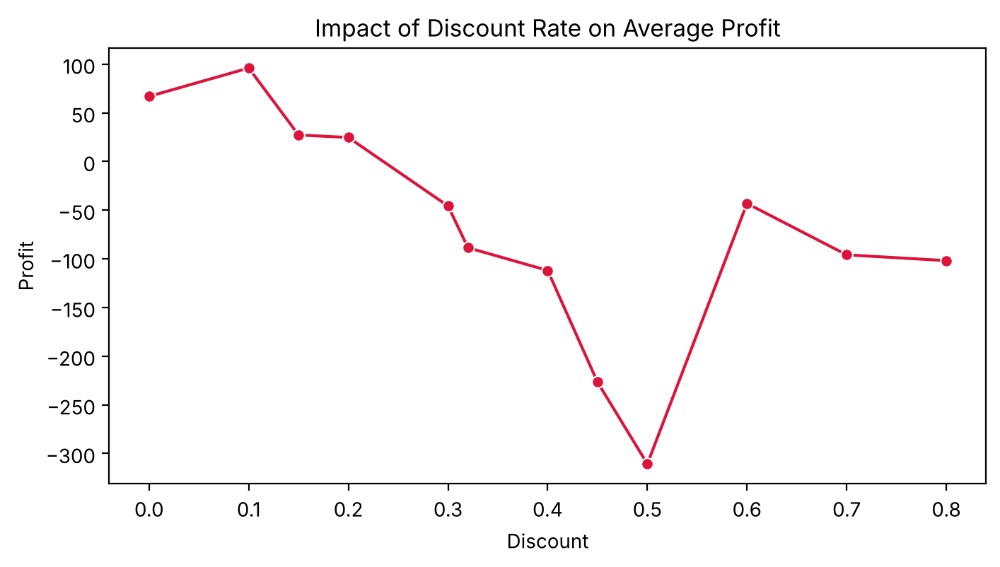
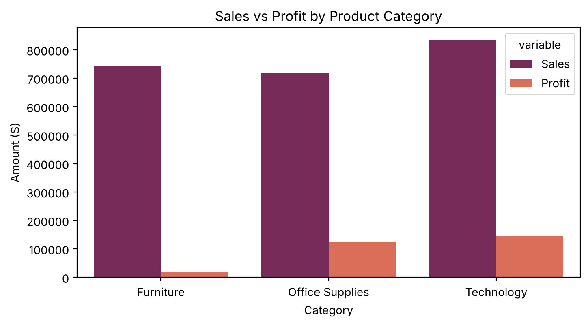
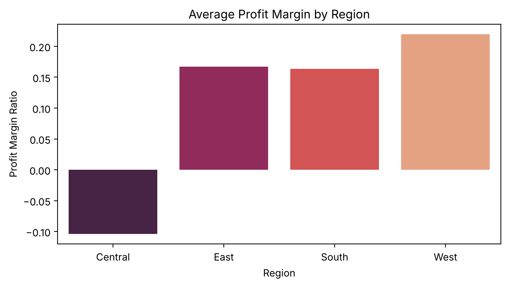

# Superstore Sales Analysis: Python EDA

Exploratory data analysis of the Superstore orders dataset (9,994 order lines), built around a small, reusable cleaning pipeline and 10 business questions.

**Tools:** Python · pandas · NumPy · matplotlib · seaborn · Jupyter

## What's inside

| Step | Function | What it does |
|---|---|---|
| 1 | `load_dataset` | Reads CSV or Excel |
| 2 | `inspect_dataset` | Shape, dtypes, missing values, memory |
| 3 | `handle_missing_values` | Drops index columns, imputes from a column→value dict (e.g. Postal Code) |
| 4 | `handle_outliers_iqr` | Caps (or removes) outliers using the IQR rule |
| 5 | `engineer_features` | Shipping duration, profit margin, order month/year, sales tiers (terciles) |
| 6 | `optimize_memory` | Category dtypes + numeric downcasting |
| 7 | `build_kpi_summary` | Revenue, profit, margin, orders, units, avg shipping time |

## Headline KPIs

| Metric | Value |
|---|---|
| Total Revenue | $2,297,201 |
| Total Profit | $286,397 |
| Overall Profit Margin | 12.47% |
| Total Orders | 5,009 |
| Units Sold | 37,873 |
| Avg Shipping Time | 4.0 days |

> Totals and rankings use the uncapped data. IQR outlier capping is applied only where outliers would distort a distribution (correlation matrix, profit box plot).

## Key findings

**Discounts destroy profit.** Discount has a strong negative correlation with profit margin (-0.83) and a moderate negative one with profit (-0.50). Average profit per order line peaks at a 10% discount and turns negative from 30% upward, which supports capping discounts at 20%.



**Furniture sells but barely earns.** Furniture brings in about as much revenue as Office Supplies ($742K) but only $18K profit. Technology leads on both revenue and profit, and Tables is the biggest loss-making sub-category (-$17.7K).



**Central has the weakest margins.** West has the best average margin, East and South are similar, and Central's average line-level margin is negative even though its total profit is positive.



**Sales are seasonal and growing.** Roughly half of annual revenue comes in September to December, and sales grew 51% from 2016 to 2019. California and New York are the top two states.

The remaining questions (segments, shipping modes, sales tiers, sub-categories) are answered in the notebook, with all charts in [`images/`](images/).

## How to run

```bash
pip install -r requirements.txt
# put the dataset in data/ (see data/README.md)
jupyter notebook superstore_eda.ipynb
```

## Files

```
superstore-sales-eda-python/
├── superstore_eda.ipynb   # the analysis
├── images/                # exported charts
├── data/                  # dataset
└── requirements.txt
```
